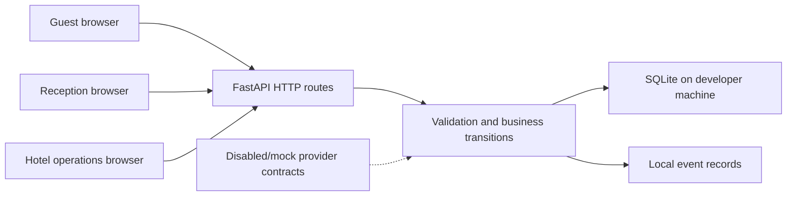
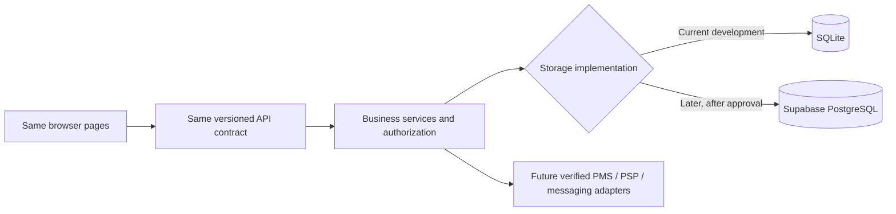

# Worthkind Flow — Database portability contract

**Decision (19 November 2026):** Build a normal web application now with **SQLite for development instead of Supabase**, then migrate the backend persistence later. **SQLite does not mean offline-first**, and users should never need to install SQLite or connect directly to the database.

## Current end-to-end architecture

Only the FastAPI development server opens SQLite. Browser pages always communicate through HTTP APIs; no database credentials or SQL are provided to the browser. Public FAQ, receipt, reception queue, departmental tickets and operations dashboard use working data already persisted in SQLite.

## Later Supabase migration — preserve behavior, change backing service

Keep API shapes, status meanings, idempotency, query scoping, case ownership and traceability independent of SQLite table syntax. The migration is **not implemented**; the current FastAPI routes still directly use sqlite3, and some business logic currently lives in route functions. We should first extract repository interfaces and transactions without breaking tested behavior, then implement a PostgreSQL version behind those interfaces.

## Invariants every storage backend must pass

| Contract | Current SQLite reference | Future adapter test |
| --- | --- | --- |
| Property scoping | Where property_id, both hotel negative tests | Tenant membership + RLS, wrong-property denial |
| Unique client request | UNIQUE(property_id, request_key), payload hash conflict | Exact once case/event under retries |
| Receipt privacy | SHA-256 stored, guest header proof, no-store | Authorized guest read only, no token in logs |
| Atomic state | BEGIN IMMEDIATE, case+audit+pending event transaction | Serializable/conditional row updates and transactional outbox |
| Department work | Tickets per property, assignment+transition+history+outbox | Staff identity/RBAC and transaction equivalent |
| Public facts | Draft private, version check, separate approval boundary | Verified manager permission, approved source history |
| Overview metrics | Counts and recent sanitized records from actual SQLite | Same meaning, real data provenance and privacy |
| Provider outcomes | No delivery or bookings implied | Explicit provider accepted/delivered/confirmed receipts |
| Operations | Synthetic data only, local file | Backup/restore, migration rollback, customer-data retention and audit |

## Migration stages when authorized

1. Freeze API and end-to-end contract tests with synthetic records.
2. Extract transaction-bound repository calls from current route modules, retaining the SQLite implementation for development.
3. Add production-grade identity and property-level authorization; local shared keys are NOT production-ready.
4. Provision Supabase project only with the owner's authorization, then apply reviewed schema/migrations (not automatically from a GitHub PR).
5. Build PostgreSQL adapter, enforce RLS and prevent arbitrary browser or untrusted request headers from choosing DB actor context.
6. Test both backends against the same black-box API invariants; rehearse import/export and rollback on nonproduction synthetic data.
7. Cut over only after privacy, observability, incidents, owner approval and an authorized hotel pilot meet the release gates.

## Explicit limits

- Local developer runner binds to 127.0.0.1 because the current shared-key prototype handles plaintext synthetic cases; this does **not** make the intended product an offline app.
- App needs the FastAPI server for normal use, whether that server reads SQLite now or Supabase later.
- A deployed application or shared hotel pilot requires genuine identity, data protection, logs/secrets and approved integrations. Changing the database URL alone will not make the dev app safe for production.
- Payment, PMS, AI and messaging can have local fake adapters and contract tests while real credentials are unavailable; their results must be labeled simulated, not live.

## SQLite adapter extraction checkpoint

The SQLite connection and transaction lifecycle was moved to `apps/api/storage_sqlite.py` in draft PR #62, with tests for committed records across requests, FK enforcement and rollback. This is **implemented** at the connection boundary only. Existing domain SQL and some business logic remain directly coupled to SQLite in API modules; full repository abstraction and a PostgreSQL adapter are NOT implemented yet.

When hosting later, the running API needs access to its own persistent database. A cloud-hosted service cannot use a SQLite file residing only on the founder's laptop or phone, and an ephemeral serverless filesystem (such as ordinary Vercel functions) is not durable application storage. A persistent server volume is one potential staging option, but **managed Supabase PostgreSQL remains the intended later production database after approval**. This decision does not make the product offline-only.
