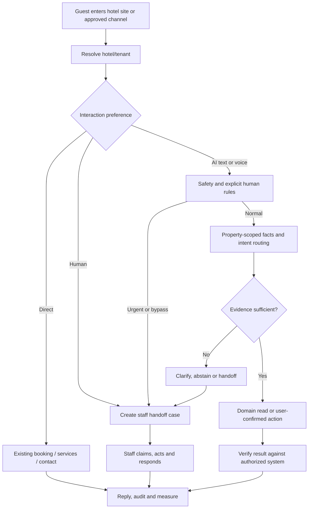
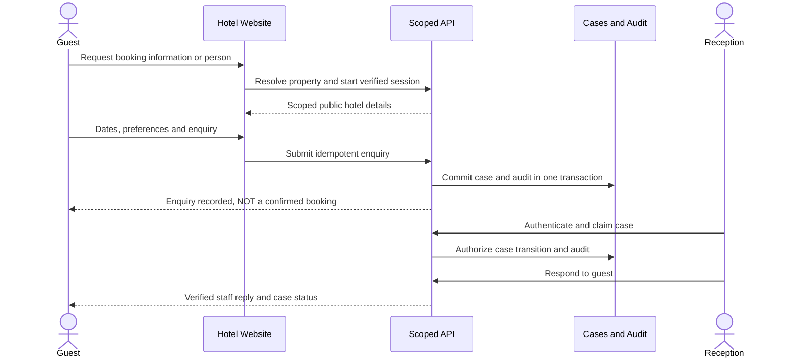
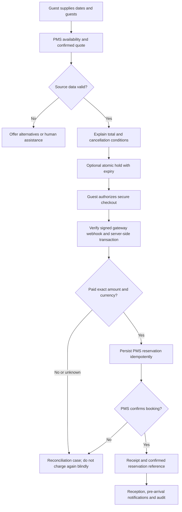
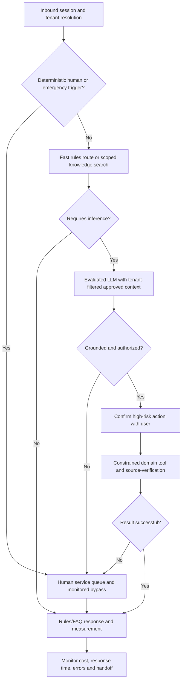
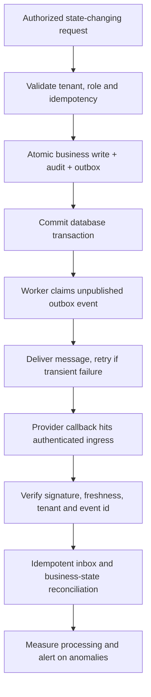

# Process flows — architecture source

These are **logical** process diagrams. Staff, guest, provider, payment and hotel systems are independent trust boundaries.

## 1. Guest service routing

## 2. Enquiry-first release

## 3. Authorized future reservation

## 4. ML and safe inference

## 5. Transactional outbox and inbound callbacks

## Why separate flows?

The guest interaction path must function even if AI is disabled. The payment path cannot assert success until external authoritative evidence exists. The human path must have owner, queue, acknowledgement and outcome. ML may classify intent but does not replace explicit access and financial controls.
